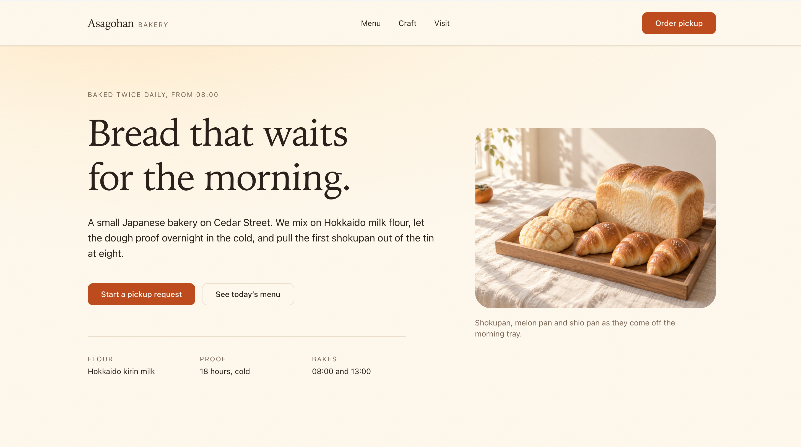
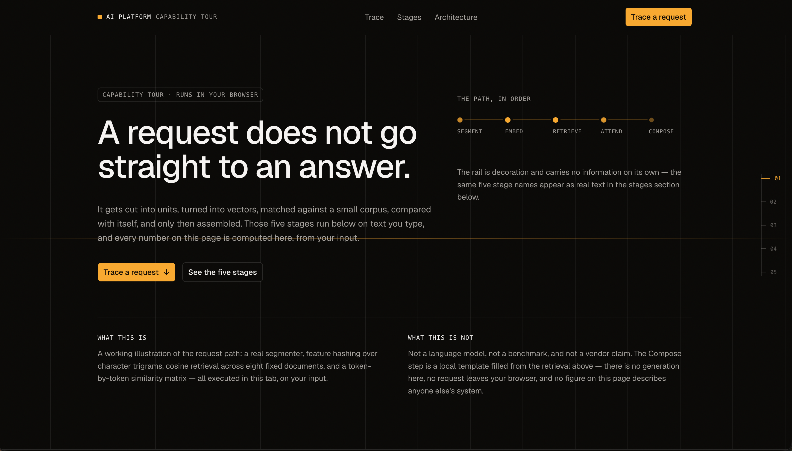
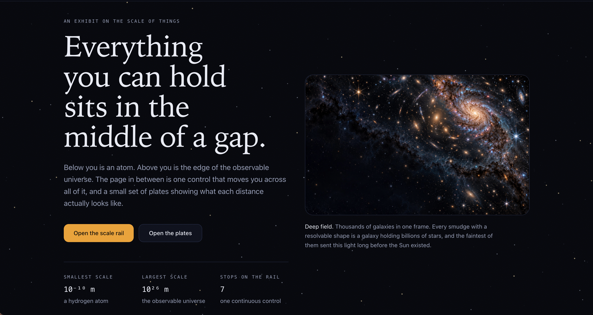

<div align="center">

# Component-Driven Frontend

### Turn product intent into verified, expressive interfaces

<p>
  A design-aware Agent skill for planning and building polished React interfaces
  with verified components, coherent visual direction, and responsive visual QA.
</p>

<p>
  <a href="README.zh-CN.md">中文文档</a>
  ·
  <a href="SKILL.md">Skill instructions</a>
</p>

</div>

<p align="center">
  
  
  
</p>

<p align="center">
  <em>Three visual directions. One evidence-driven component workflow.</em>
</p>

## What this skill does

`component-driven-frontend` helps turn a product brief into a practical component
plan and a production-ready implementation. It is designed for interfaces where
component selection, visual language, composition, responsive behavior, and
accessibility require real judgment.

The skill:

- inspects the existing project before choosing a foundation or component;
- turns product intent into an explicit visual direction;
- searches for inspiration without copying unverifiable references;
- verifies project components and source APIs before recommending them;
- limits the implementation to one foundation and at most one visual enhancer;
- plans multi-page shells from the real route map;
- produces and validates a machine-readable component plan;
- carries the plan into implementation and rendered desktop/mobile QA;
- checks contrast, visual regressions, localization expansion, and build budgets before a
  page is called done.

## When to use it

Use this skill when you are:

- designing or implementing a React page from a product brief;
- selecting components from an existing design system or registry;
- defining a visual direction for a new product surface;
- composing a dashboard, landing page, product shell, or content-heavy interface;
- improving a UI where responsive, accessibility, and visual-system decisions matter.

Do not use it for reducer bugs, state-transition defects, or an isolated style edit
whose exact target and value are already known.

## Workflow

```text
Project inspection
      ↓
Design intent + visual direction
      ↓
Content, responsive, and performance boundaries
      ↓
Verified component and source selection
      ↓
Validated component plan
      ↓
Implementation with existing tokens
      ↓
Rendered desktop/mobile visual QA
```

The complete operating instructions are in [`SKILL.md`](SKILL.md). Supporting
guidance lives in [`references/`](references/), while deterministic helpers and
validators live in [`scripts/`](scripts/).

## Visual directions

### Warmth

Human-centered interfaces with approachable rhythm, clear emotional intent, and
content that feels considered rather than mechanically assembled.

### AI product

Focused product surfaces where hierarchy, interaction states, data density, and
trustworthy system feedback are more important than decoration.

### Science

Technical interfaces that make complex information legible through disciplined
layout, evidence, progressive disclosure, and strong responsive behavior.

These images are visual references, not component sources. The skill uses them to
discuss direction and intent; it never treats an inspiration image as proof that
a component or API exists.

## Repository layout

```text
.
├── README.md                         # English documentation
├── README.zh-CN.md                   # Chinese documentation
├── SKILL.md                          # Skill workflow and guardrails
├── assets/                           # Visual references
│   ├── warmth.png                    # Warmth visual reference
│   ├── aiProduct.png                 # AI product visual reference
│   └── science.png                   # Science visual reference
├── references/                       # Detailed domain guidance
├── schemas/                          # Machine-readable plan contracts
├── examples/                         # Canonical plan, validated in tests
└── scripts/                          # Inspection, search, and validation tools
```

## Example prompts

[Runnable support dashboard](examples/support-dashboard/README.md) pairs the component plan with an offline page, desktop and 320px browser captures, and a reproducible reflow regression. Its Playwright suite exercises keyboard access and axe on the rendered page.

```text
Build a responsive analytics dashboard for operations teams.
Inspect the existing design system, propose two visual directions,
choose one, verify the available table and chart components, and produce
a validated component plan before implementation.
```

```text
Create a polished landing page for an AI writing product.
Use the user's stated feeling "calm and trustworthy", keep the existing
foundation, and review the rendered desktop and mobile states before
considering the work complete.
```

## Design principles

1. Evidence outranks novelty.
2. Existing project foundations should be preserved.
3. Inspiration informs direction; it does not authorize copying.
4. A named component must be verified before it is selected.
5. Content realism, responsive behavior, accessibility, and performance are part
   of visual quality.
6. A page is not complete until its rendered desktop and mobile states have been
   inspected.

## Checks

```bash
node --test
```

Runs the planner, validator, CLI, and component-query suites. Every script is plain
ESM with no dependencies to install. Validating a plan against a project also checks
the declared foundation, enhancer, installed dependencies, and every declared contrast
pair:

```bash
node scripts/validate-component-plan.mjs --file plan.json --root . --strict
```

Derive the type scale from one ratio so sizes stop being per-component guesses:

```bash
node scripts/type-scale.mjs --body 16 --ratio 1.25 --format css
```

The approved plan also generates the rendered-review checklist and an optional Playwright
spec, so visual QA is worked through instead of recalled:

```bash
node scripts/visual-qa-plan.mjs --file plan.json --root . --out qa.md
node scripts/visual-qa-plan.mjs --file plan.json --root . --emit playwright --out qa.spec.ts
node scripts/check-contrast.mjs --root . --pairs 'foreground:background,muted-foreground:background'
```

`check-contrast` reads the project's theme tokens (hex, `rgb()`, `hsl()`, `oklab()`, `oklch()`)
and fails below 4.5:1 for text and 3:1 for large text and UI boundaries.

Run the close-out checks locally with `node scripts/verify.mjs --plan plan.json --root .`. Missing optional inputs are reported as skipped. In a CI job, generate the build and captures first, then name the checks that must run.

```bash
node scripts/verify.mjs --plan plan.json --root . --require bundle,regression,i18n --json
```

`--require` accepts `plan`, `bundle`, `i18n`, and `regression`. A missing required input or a failed check exits 1. Warnings allow exit 0. An unknown name or an overlap with `--skip` exits 2. Required regression checks also fail when a new capture lacks its own baseline. Required bundle checks need measurable JS or CSS and any JS/CSS files referenced by the inspected route entries.

Both locale commands read flat catalogs (`en.json`) and language directories (`en/common.json`, `zh/admin/forms.json`). The relative filename supplies the namespace, so the last file’s `save` key is reported as `admin.forms.save`. Flat and nested catalogs can coexist. Files that define the same key in one locale produce an error identifying both paths.

The individual checks stay available:

```bash
node scripts/inspect-shell.mjs --root . --json
node scripts/brand-colors.mjs --root . --json
node scripts/plan-diff.mjs --before old-plan.json --after plan.json --fail-on foundation,regions
node scripts/visual-regression.mjs --baseline qa/baseline --current qa --update
node scripts/i18n-stress.mjs --dir locales --baseline en
node scripts/bundle-budget.mjs --root . --plan plan.json
```

`inspect-shell` inventories routes, layout chains, route groups, and segment states so a
multi-page shell starts from the real map. `visual-regression` decodes PNG captures with no
dependencies, fails on a changed canvas size, and reports a bounding box plus a difference hash;
`i18n-stress` checks key parity, placeholder drift, and text expansion against a baseline locale;
`bundle-budget` measures per-route first-load JS and shipped CSS against the plan's budget.

## License

See the repository license and project policy for usage terms.
