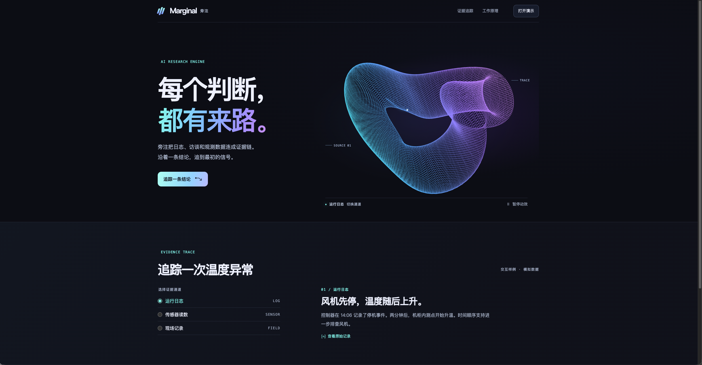
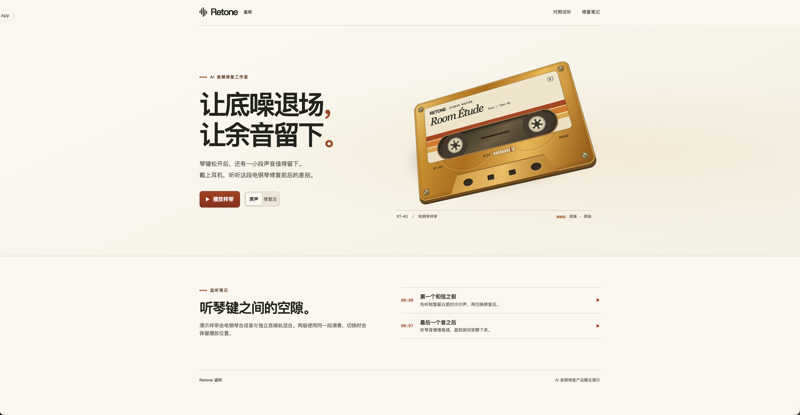

<div align="center">

# Component-Driven Frontend

### 将产品意图转化为经过验证、富有表现力的界面

<p>
  面向 Agent 的网页设计技能，支持从需求做设计、评审已有界面，以及在项目技术栈中实现和验收。
</p>

<p>
  <a href="README.md">English</a>
  ·
  <a href="SKILL.md">Skill instructions</a>
</p>

</div>

<p align="center">
  
  
  
</p>

## 这个 skill 解决什么问题

先确定访客要完成的事，再用同一份真实内容比较构图。主管要处理风险账户，账户名、阻塞原因和操作适合放在一起。编辑要比较照片，接触印样能让差异一眼可见。读者要理解一篇文章，标题断行、正文行长和图注位置都影响阅读顺序。

| 手头的材料 | 交付物 |
| --- | --- |
| 方向开放的设计需求 | 两张用相同素材绘制的首屏草图、选定的阅读顺序、窄屏处理和取舍。已有明确参考时直接细化。 |
| 截图或已有页面 | 标出可见问题的位置、它如何影响访客、具体改法，以及如何复验。 |
| 实现需求 | 沿用现有技术栈完成页面并做渲染验收。需要选组件的 React 项目继续使用来源验证、方案校验和 CI 工具。 |

设计与评审可在没有代码仓库时使用。局部控件调整保留已定构图，按项目已有 token 和状态验收。

从第一稿就考虑使用者此刻的处境。主管看到调度受阻，能否一眼知道谁在跟进？读者看到老周说“只写你看得准的字”，下一段是否给这句话留了片刻？把取舍落在当事人、图像、断句或交互上，再用同一处画面复看。首稿先给主角留出空间。标签靠近数值，两件不同的事之间留一段空白。删去重复说明和多余的卡片边框，再决定哪一处值得用渐变。毛玻璃和短动效可以留给随后打开的详情。用户开启减少透明度或减少动态效果时，界面会采用实色或即时切换。新项目的按钮和输入框默认用柔和的小圆角，卡片和弹窗随尺寸加大圆角，单选框保持正圆。已有设计系统时沿用品牌规范。[组件圆角与单选框示例](references/visual-language.md#build-shape-rhythm)

正文、标题和容器一起定尺寸。工作台在宽屏并排展示账户与摘要，平板把三项指标排成一行，手机把辅助指标收进可展开的摘要。标题允许换行，表格入口留足点按空间。[字号、行长与组件尺寸](references/premium-craft.md#set-the-type-scale)

把按钮的文字、图形和点击区域一起设计。箭头可以引导视线，也可以呼应产品的视觉语言。先看笔画与字重是否协调，再调图文间距、边缘留白和动效方向。主操作可以更有表现力，次要操作可以更安静。[按钮文字与图标取舍](references/iconography-and-imagery.md#choose-the-action-label-first)

根据产品任务选择控件、空间造型与动效。[组件设计](references/visual-language.md#derive-a-control-family) · [空间设计指南](references/spatial-design.md)

## 产品设计预览

| 旁注 · AI 研究助手 | 返听 · AI 音频修复 |
| --- | --- |
| [](assets/marginal.webp) | [](assets/retone.webp) |

## 工作流

明确访客目的 → 编辑内容 → 方向开放时并排看两张草图 → 选择构图和阅读顺序 → 在实际尺寸下检查。组件实现继续走来源验证、方案校验、开发和 CI。

完整操作说明见 [`SKILL.md`](SKILL.md)。详细领域指导位于
[`references/`](references/)，确定性脚本和校验工具位于 [`scripts/`](scripts/)。

## 目录结构

```text
.
├── README.md                         # 默认英文文档
├── README.zh-CN.md                   # 中文文档
├── SKILL.md                          # Skill 工作流和边界
├── references/                       # 详细领域指导
├── schemas/                          # 机器可读的方案契约
└── scripts/                          # 检查、搜索和校验工具
```

## 使用示例

```text
为运营团队构建一个响应式数据分析 Dashboard。
先检查现有设计系统，提出两个视觉方向并选择一个，
验证可用的表格和图表组件，在实现前先生成并校验组件方案。
```

```text
请评审这张 320px 的中文随笔截图。图注看起来属于哪张图？
指出间距如何造成这种阅读顺序，给一项能复验的调整。只需要反馈。
```

## 设计原则

1. 证据优先于新奇感。
2. 优先保留项目已有的基础设计系统。
3. 灵感用于确定方向，不等于允许复制。
4. 组件名称必须在选用前完成验证。
5. 内容真实性、响应式、可访问性和性能都属于视觉质量的一部分。
6. 只有完成桌面端和移动端渲染检查后，页面才算完成。

## 自检

```bash
node --test
```

运行计划器、校验器、CLI 和组件检索的测试套件。核心 CLI 采用零依赖 ESM。
带项目根目录校验计划时，还会同时检查声明的 foundation、enhancer、依赖安装状态，
以及每一条声明的对比度配对：

```bash
node scripts/validate-component-plan.mjs --file plan.json --root . --strict
```

当项目还没有字号体系时，可以从一个比例推导起始字号阶梯。

```bash
node scripts/type-scale.mjs --body 16 --ratio 1.25 --format css
```

通过校验的方案可以直接生成渲染验收清单和可选的 Playwright 骨架，让视觉验收变成逐项核对，
而不是凭记忆：

```bash
node scripts/visual-qa-plan.mjs --file plan.json --root . --out qa.md
node scripts/visual-qa-plan.mjs --file plan.json --root . --emit playwright --out qa.spec.ts
node scripts/check-contrast.mjs --root . --pairs 'foreground:background,muted-foreground:background'
```

`check-contrast` 直接读取项目主题 token（支持 hex、`rgb()`、`hsl()`、`oklab()`、`oklch()`），
正文低于 4.5:1、大字与 UI 边界低于 3:1 时判为失败。

本地运行 `node scripts/verify.mjs --plan plan.json --root .`，缺少输入的可选检查会标为跳过。在 CI 中先生成构建产物和当前截图，再按项目需要指定必检项。

```bash
node scripts/verify.mjs --plan plan.json --root . --require bundle,regression,i18n --json
```

`--require` 可选 `plan`、`bundle`、`i18n`、`regression`，支持逗号分隔或重复传入。缺少必检输入或检查失败时退出码为 1，仅有警告时为 0。未知检查名、空名称或与 `--skip` 冲突时为 2。视觉回归列为必检后，每张新截图都需要对应基线。体积检查列为必检后，需要可测量的 JS 或 CSS，以及已检查路由所引用的资源文件。

独立多语言命令和总验收共用目录读取逻辑。`en.json` 的键保留原名，`en/common.json` 中的 `save` 对应 `common.save`，`zh/admin/forms.json` 中的 `save` 对应 `admin.forms.save`。平铺和分目录格式可以共存，同一语言的两个文件定义相同键时，错误会给出键名和双方路径。

单项检查仍然可以单独运行：

```bash
node scripts/inspect-shell.mjs --root . --json
node scripts/brand-colors.mjs --root . --json
node scripts/plan-diff.mjs --before old-plan.json --after plan.json --fail-on foundation,regions
node scripts/visual-regression.mjs --baseline qa/baseline --current qa --update
node scripts/i18n-stress.mjs --dir locales --baseline en
node scripts/bundle-budget.mjs --root . --plan plan.json
```

`inspect-shell` 输出路由、layout 链、route group 和分段状态，多页面壳层从真实路由图开始；
`visual-regression` 零依赖解码 PNG 截图，画布尺寸变化一律判失败，并输出差异包围盒与差值哈希；
`i18n-stress` 检查 key 完整性、占位符漂移和相对基线语言的文本膨胀；`bundle-budget` 按方案预算
检查每条路由的首屏 JS 与 CSS 体积。

## License

使用条款请参考仓库中的 License 和项目规范。
