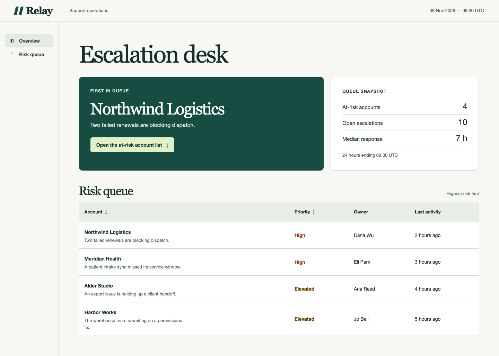
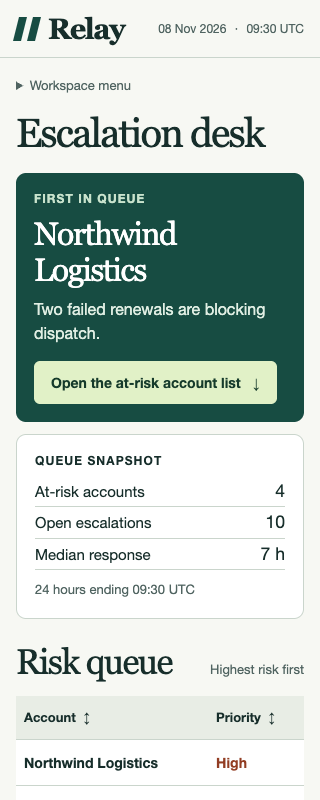
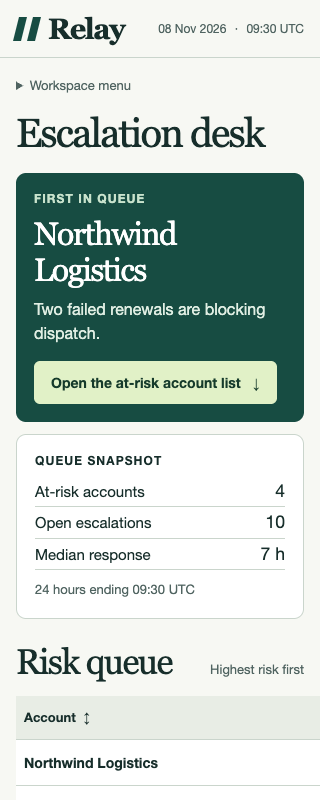

# 客服运营 Dashboard

直接用浏览器打开 [index.html](index.html) 即可体验。页面使用固定的虚构账户快照，可以离线运行。选择最优先的账户、打开详情、按 Esc 返回，是这个案例的主流程。

| 桌面，1440px | 窄屏，320px |
| --- | --- |
|  |  |

## 方案如何落到页面

- 首屏直接写出 Northwind Logistics 和阻塞调度的原因，旁边给出同一快照的统计时间。读者可以先判断要处理谁，再核对队列。“十秒内识别账户”仍需真人计时验证。
- 主按钮将焦点送到当前排序的第一条账户。上下方向键在账户之间移动，Enter 打开详情，Esc 返回原账户。列标题支持排序并向辅助技术报告排序方向。
- 320px 保留账户和优先级两列。风险原因、负责人和最近活动都能在详情中读取。侧边导航折叠为菜单。
- 对应方案中的 `summary` 与 `results` 两个区域，页面使用原生 HTML、CSS、JavaScript、表格和对话框，便于移植到已有项目。原方案列出的 React/shadcn 组件属于目标项目的组件选择。[组件方案](../component-plan.example.json)

## 一次窄屏回归

下面两张图使用同一份数据、同一浏览器和同一视口。测试临时给表格施加 680px 最小宽度，复现优先级列滑出屏幕的问题。移除该规则后，页面水平溢出为 0px。测试随后打开首行详情，断言负责人和最近活动仍然可读。[复现用例](dashboard.spec.mjs)

| 注入固定宽度 | 启用响应式布局 |
| --- | --- |
|  |  |

## 复验

浏览页面无需安装依赖。运行浏览器测试需要 Node.js 22.16 或更高版本。从仓库根目录执行以下命令。

```bash
cd examples/support-dashboard
npm ci
npx playwright install chromium
npm test
```

已安装 Google Chrome 的机器也可用 `PW_CHANNEL=chrome npm test`。测试直接打开本地 HTML，快照保存在 `qa/`。页面视图与状态均使用固定数据。

- `npm test` 从组件方案重新生成 Playwright 脚本，在四种宽度检查页面和区域溢出、Tab 可达性、axe 扫描，并包含减少动态效果的截图。
- 案例专用用例覆盖排序、键盘打开和返回、320px 信息保留及四种数据状态。几何用例曾测出 320px 从正常切换到加载状态时，队列标题向上移动约 60px。为账户名和原因各预留两行后，复验要求桌面与 320px 的队列标题位置偏差均不超过 1px。通用生成器的四个状态几何占位用例会明确跳过。可在页面地址后加 `?state=loading`、`?state=empty` 或 `?state=error` 单独查看；错误状态保留上次快照并提供 Retry。
- `npm test` 最后运行 `qa:prove`。它在隔离目录实际执行生成的脚本，要求健康页面通过，仅可鼠标访问的可见按钮触发键盘失败，无名称按钮触发 axe 失败，缺少 axe 包的项目报告跳过。只有观察到预期结果，对照测试才通过。
